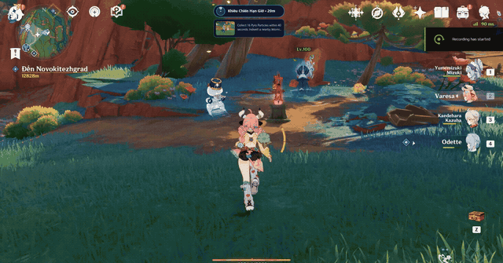
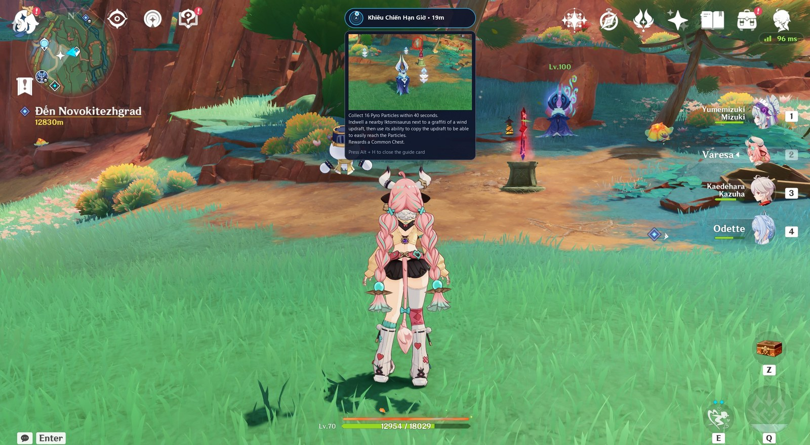
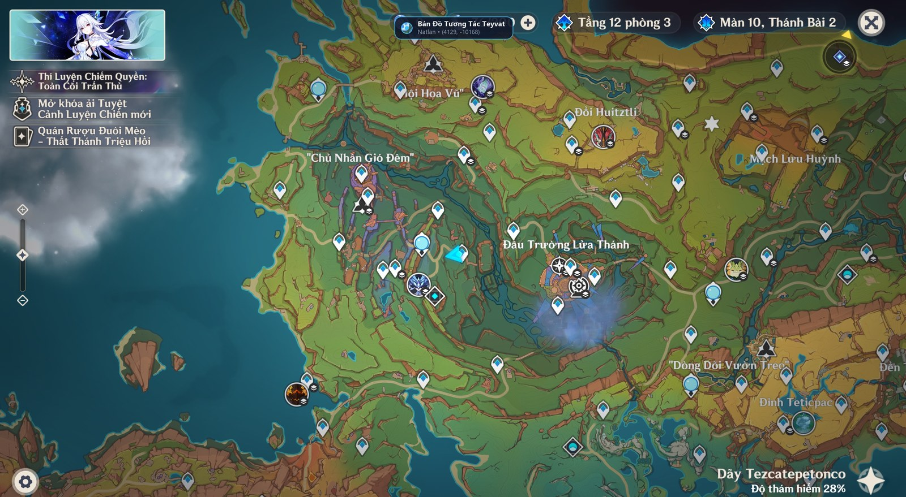
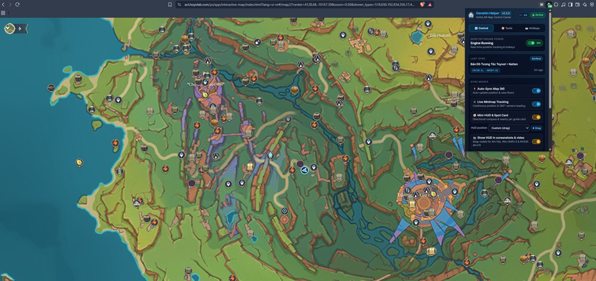

<div align="center">
  
  <h1>Genshin-Helper v5.5.0</h1>
  <p><strong>100% Passive Computer Vision Map Sync &amp; 360° Live Navigation Overlay for HoYoLAB Interactive Map</strong></p>
  <p>
    <strong>English</strong> | <a href="README.vi.md">Tiếng Việt</a>
  </p>
  <p>
    <a href="https://github.com/tuanminh26596/Genshin-helper/releases"></a>
    <a href="https://github.com/tuanminh26596/Genshin-helper/actions/workflows/ci.yml"></a>
    
    <a href="LICENSE"></a>
    <a href="https://ko-fi.com/minmories"></a>
  </p>
</div>

<p align="center">
  
</p>

---

## Overview

**Genshin-Helper** is a local-only, 100% passive Computer Vision companion for **Genshin Impact (Windows 10/11 64-bit PC client)** that synchronizes your real-time position and 360° camera view onto the official **HoYoLAB Interactive Map** — while projecting an ultra-low-latency click-through navigation HUD over the game so you can farm Oculi, Chests, and Puzzles without constantly Alt-Tabbing.

### What's New & Key Features (`v5.5.0`)

- **360° Camera-Synced Mini-HUD & Proximity Guide Card:** Click-through Win32 layered overlay (`UpdateLayeredWindow`, `WDA_EXCLUDEFROMCAPTURE` by default) with a 30 Hz spring needle, close-range radar, on-demand Guide Card (`Alt + H`) showing HoYoLAB community notes + screenshot, and toggleable visibility for screenshots (`Win+Shift+S`), OBS, Share Screen, and NVIDIA `Alt + F9` (with Desktop Capture enabled).
- **Distance-First Smart Pin Prioritization & Lossless Web Sync:** Always prioritizes the closest uncollected pins first, breaking close ties by value (**Oculi/Offerings > Shrines/Luxurious > Special Chests > Common Chests > Puzzles > Specialties**), plus automatic HoYoLAB pin dimming self-heal (`extension/page_main.js`) so web markers dim reliably when marked from in-game (`Alt + F`).
- **60 Hz Minimap Heading Fast-Path & Full-Teyvat Relocation (`V5.3+`):** Hybrid SIFT + zero-mean Sobel tracking with automatic Surface ↔ Underground cave floor switching, runtime Paimon anchor auto-calibration, and offline RootSIFT global auto-relocation when teleporting across regions.
- **Exact Map (`M`) Auto-Sync:** Dual-gated template & terrain alignment with multi-map support (Teyvat, Enkanomiya, The Chasm, Sea of Bygone Eras, Ancient Sacred Mountain, Temple of Space, Nod-Krai).
- **Smart Hotkey Conflict Advisor & NVIDIA Overlay Remapper:** Detects internal duplicates, Genshin Impact menu keys that leak even with modifiers (such as `G`, `Alt + G`, `Alt + Shift + G`, `Z`), OS `RegisterHotKey` collisions, and NVIDIA Overlay shortcuts (`Alt + Z`, etc.) — with explicit user confirmation to remap NVIDIA's shortcut cleanly (automatic backup + 1-click restore) and `WH_KEYBOARD_LL` trigger-key suppression in-game (zero `SendInput`).
- **Browser Extension Control Center (MV3) & Single-Monitor Tools:** Zero-clutter HoYoLAB map surface, toolbar badge (`ON` / `ZZZ` Standby at 0% CPU / `OFF`), Native Messaging auto-wake, TSP shortest-path farming route planner, Cross-Map Pin Exporter (`Kongying`, `genshinmap.github.io`, `Appsample`), and opt-in LAN Companion view.

### Screenshots

<p align="center">
  
  
</p>
<p align="center">
  
</p>

---

## Disclaimer, Anti-Cheat Safety & Transparency

Please read all 6 points carefully before installing or using Genshin-Helper:

1. **Honest Risk & Terms of Service Notice (Please Read):**
   - **Real-world context:** The author uses this tool **daily on a personal account** and specifically engineered it around strict passive principles: **zero game memory reads/writes**, **zero DLL injection**, **zero DirectX hooks**, and **zero `SendInput` / synthetic keystrokes or mouse clicks** sent to the game window.
   - **Important warning:** Regardless of how passive it is designed to be, Genshin-Helper is still an **unofficial third-party application** interacting alongside a live game, not affiliated with or endorsed by **HoYoverse / COGNOSPHERE PTE. LTD.** Nobody can guarantee a **0% account ban risk**, and HoYoverse's Terms of Service or Anti-Cheat detection rules can change at any time without notice. **You choose to use this software at your own discretion and full personal responsibility.**
2. **Windows SmartScreen / Antivirus False Positives:**
   - Open-source releases built without a paid commercial Code Signing certificate — especially apps using Windows Desktop Capture and global low-level hotkey hooks (`WH_KEYBOARD_LL` / `WH_MOUSE_LL`) — may trigger a **Windows SmartScreen** prompt or an overly cautious antivirus alert.
   - Every official `Setup.exe` is compiled cleanly in the open from the pure-Rust 7-crate backend on [GitHub Actions](https://github.com/tuanminh26596/Genshin-helper/actions) with published `SHA256SUMS.txt` checksums. If you prefer, you can inspect every line of Rust/JS code and build directly from source (`~7.13 MB` Setup EXE, `0` external DLLs).
3. **Administrator Privileges & Scheduled Task:**
   - Because Genshin Impact runs elevated (Administrator), Windows UIPI blocks hotkeys and overlays from standard non-elevated apps. The Setup installer configures an elevated Windows Scheduled Task (`GenshinHelper_Elevated`) so the Extension popup can wake the engine cleanly without repeated UAC prompts. Uninstalling removes this task and all registry keys cleanly.
4. **NVIDIA Overlay Shortcut Modification (Opt-In Only):**
   - When you choose to claim a key used by NVIDIA Overlay (for example `Alt + Z`), changes are written to NVIDIA's settings **only after your explicit click** in the Popup, always saving an automatic backup for 1-click undo.
5. **Privacy & HoYoLAB Data:**
   - On first run, Genshin-Helper downloads public HoYoLAB map metadata and terrain tiles (~15 MB) directly to `%LOCALAPPDATA%\GenshinHelper\data`.
   - It **never asks for, reads, or transmits** your HoYoLAB password or login cookies (`ltoken_v2`, `cookie_token`). Local transport binds strictly to `127.0.0.1:8765` with zero analytics/telemetry.
   - Diagnostic bundles (`Alt + F12`) automatically blur the bottom-right UID area, though you should still double-check screenshots before sharing them on public GitHub Issues.
6. **Supported Scope & No Warranty:**
   - Supports **Windows 10 / 11 (64-bit)** PC client only (not Mobile, Console, Linux/macOS, or Cloud Gaming).
   - Released as a free personal/hobby open-source project under the [MIT License](LICENSE) **AS IS**, with updates provided on a best-effort basis when new regions or game updates release. See [SECURITY.md](SECURITY.md) and [THIRD_PARTY_NOTICES.md](THIRD_PARTY_NOTICES.md).

---

## Quick Start (Recommended)

### Option 1: Windows Setup Installer (`GenshinHelper-Setup-v5.5.0.exe`, ~7.15 MB, 0 External DLLs)

1. Download **`GenshinHelper-Setup-v5.5.0.exe`** (and verify with `SHA256SUMS.txt` if desired) from [**GitHub Releases**](https://github.com/tuanminh26596/Genshin-helper/releases).
2. Run the installer and accept the elevation prompt so hotkeys work over the game.
3. At the end of installation, the bundled **Browser Extension Setup Guide** (`install_extension.html`) opens automatically:
   - Open `chrome://extensions` (or `edge://extensions` / `brave://extensions`).
   - Enable **Developer mode**, click **Load unpacked**, and paste the extension path shown on the guide page.
   - Pin the **Genshin Helper** icon to your browser toolbar (fixed Extension ID: `nfkijdoblmphmdljfogooajhbldkeojh`).
4. On first launch, the Desktop App (`GenshinHelper.exe`) automatically downloads the public HoYoLAB map cache into `%LOCALAPPDATA%\GenshinHelper\data` (watch the System Tray tooltip; takes ~10–20 seconds once).
5. Open [**HoYoLAB Interactive Map**](https://act.hoyolab.com/ys/app/interactive-map/index.html#/map/2), launch Genshin Impact in **Borderless Windowed**, press **`M`** once to lock your starting position, and explore!

### Option 2: Build & Run from Source (Windows 10/11 64-bit, Rust 1.92+ / Edition 2024)

Prerequisites: [Rustup (`msvc` stable toolchain)](https://rustup.rs/) and Visual Studio Build Tools (C++ workload).

```powershell
git clone https://github.com/tuanminh26596/Genshin-helper.git
cd Genshin-helper

Copy-Item config.example.json config.json
cargo build --manifest-path rust/Cargo.toml --release -p gh-app -p gh-host
```

Optionally pre-hydrate map data (on first launch `GenshinHelper.exe` also auto-hydrates and checks online `map_version`):

```powershell
cargo run --manifest-path rust/Cargo.toml --release -p gh-app -- --sync-data
```

Register the Chrome/Edge Native Messaging host for dev builds (only needed when running from source without the Setup installer) and load the unpacked `extension/` folder in Chrome / Edge / Brave:

```powershell
pwsh -NoProfile -ExecutionPolicy Bypass -File scripts/register_dev_native_host.ps1
```

Then launch `GenshinHelper.exe` directly — it automatically prompts for Administrator (UAC) elevation on startup (pass `--no-elevate` or `GH_NO_ELEVATE=1` to run un-elevated; run `installer/build_release.ps1` with Inno Setup 6 to produce `dist/installer/GenshinHelper-Setup-v5.5.0.exe`).

#### CLI Flags & `hoyolab_sync` Configuration (`config.json`)

- **CLI Flags (`GenshinHelper.exe`):** `--sync-data` (download/refresh HoYoLAB assets and exit), `--no-tray`, `--standby`, `--minimized`, `--record-minimap <SECONDS>`, `--port <PORT>`, `--lan-port <LAN_PORT>`, `--config <PATH>`, `--no-mutex`, `--no-elevate`.
- **`hoyolab_sync` online map auto-check (`config.json`):** By default (`"auto_check_on_startup": true`, `"auto_update_mode": "auto_download"`), the engine checks HoYoLAB's live `map_version` on startup and refreshes changed datasets automatically. You can override `base_api`, `tile_base`, `rpc_map_version`, `default_map_ids`, `probe_id_range`, or switch `"auto_update_mode"` to `"notify_only"` or `"off"` under `"hoyolab_sync"` in `config.json`.

---

## Default Hotkeys (`v5.7.0`)

All hotkeys default to **Shift/Ctrl-free left-hand `Alt` combos** (zero Sprint/Walk interference) and can be customized live in **Extension Popup → Hotkeys** (with automatic conflict detection):

| Action | Default | Purpose |
| --- | --- | --- |
| **Mark Current HUD Target** | `Alt + F` | Marks the active Mini-HUD target on both Desktop App and HoYoLAB Web Map without Alt-Tabbing (far targets >25 m prompt double-tap confirmation). |
| **Undo Last Mark** | `Alt + T` | Reverts the last collected target in the app and unmarks it on HoYoLAB Web Map. |
| **Toggle Guide Card** | `Alt + H` | Opens/closes the in-game Guide Card with HoYoLAB community tips & screenshot. |
| **Next Target** | `Alt + E` | Cycles manually to the next nearby uncollected pin. |
| **Cancel Target Lock** | `Alt + F6` | Clears a manually locked navigation target (also available on HoYoLAB Web Map and LAN Companion). |
| **Drag HUD & Radar Layout** | `Alt + F7` | Toggles drag/resize layout mode for both the Mini-HUD and Floating Live Radar Map. |
| **Show / Hide Mini-HUD** | `Alt + X` | Toggles visibility of the in-game Mini-HUD overlay on the fly. |
| **Toggle Floating Live Radar** | ``Alt + ` `` | Enables/disables the 60 fps Floating Live Radar Map (default OFF = 0% CPU/RAM). |
| **Sync Map (`M`) & Mark Nearest** | `Alt + F11` | Captures fullscreen Map (`M`), aligns HoYoLAB map, and marks the nearest pin (<60 m). |
| **Quick Switch Game ↔ Map** | `Alt + Q` | Toggles focus between Genshin Impact and the Chrome/Edge/Brave HoYoLAB tab (always available while the engine is on). |
| **Capture Diagnostic Bundle** | `Alt + F12` | Captures privacy-blurred game/map telemetry bundle locally (`%APPDATA%\GenshinHelper\diagnostics` or `scratch/diagnostics`). |

> **Tip — Recording Mini-HUD with NVIDIA `Alt + F9`:**
> Turn on **Show HUD in screenshots & video** in Popup Control tab. That enables `WDA_NONE` for Windows screenshots (`Win+Shift+S`), OBS Display Capture, and screen sharing. Because NVIDIA ShadowPlay captures only the DirectX game surface by default, also open **NVIDIA Overlay (`Alt + Z`) → Settings → Privacy Control → enable Desktop Capture** if you want `Alt + F9` videos to include the Mini-HUD.

---

## Game Settings Compatibility Matrix

Genshin-Helper normalizes HUD geometry via Unity `CanvasScaler` rules while transparently handling **3 Windows / game limits**:

| Setting / Environment | Status | Behavior & Recommended Setup |
| --- | --- | --- |
| **Borderless Windowed / Windowed** | Full support | Recommended for Mini-HUD overlays, HUD toasts, and single-monitor play. |
| **Exclusive Fullscreen** *(Hard OS Limit)* | Limited (no overlay) | Windows DWM prevents layered HUD overlays over Exclusive Fullscreen. Use the built-in **Launch Borderless** button (`-popupwindow -screen-fullscreen 0`) or switch in game settings. |
| **Admin Privilege / UIPI** *(Hard Windows Limit)* | Requires matching elevation | Genshin Impact launches as Administrator, so non-elevated apps are blocked from global hotkeys. Install via Setup (creates elevated Scheduled Task) or run source terminal as Admin. |
| **Windows Auto-HDR / HDR** *(Hard Capture Limit)* | Degraded / SDR fallback | HDR tone-mapping shifts brightness thresholds and drops capture alpha channels. Disable **Auto-HDR** for Genshin Impact in Windows Display Settings for best CV accuracy. |
| **Aspect Ratios (`16:9`, `16:10`, `21:9`, `4:3`)** | Full support | Dynamic Unity `CanvasScaler` minimap & UI ROI normalization across ultrawide and standard monitors. |
| **Windows DPI Scaling (`100%–200%`)** | Full support | Per-monitor DPI awareness and independent X/Y scaling. |
| **Keyboard/Mouse & Gamepad HUD** | Full support | Automatic safe-area minimap detection for both input layouts. |
| **Minimap Rotation (Lock & Follow-View)** | Full support | 360° camera cone + character arrow tracking work in both modes. |

---

## Architecture Overview

```text
+----------------------------------+          localhost:8765 (HTTP)         +---------------------------------+
| Genshin-Helper Pure-Rust (Win64) | <====================================> | Chrome / Edge / Brave Extension |
|  GenshinHelper.exe (0 ext DLLs)  |   Lossless /poll?since=<seq> ring buf  |  (MV3 Service Worker + Popup)   |
|  - Passive GDI SRCCOPY Capture   |                                        |  - HoYoLAB Map DOM Bridge       |
|  - Pure-Rust Map M + Minimap CV  |        Native Messaging (stdio)        |  - Zero-Throttle Background Sync|
|  - 360° Heading & tiny-skia HUD  | <------------------------------------> |  - TSP Overlay & Pin Exporter   |
|  - Local Cache (%LOCALAPPDATA%)  |    GenshinHelperHost.exe (pinned ID)   +---------------------------------+
+----------------------------------+
```

- **Opt-in LAN Companion:** Runs separately on port `8766` (`HTTP/WS`) when enabled.

- More Extension details: [extension/README.md](extension/README.md)
- Contributing guidelines: [CONTRIBUTING.md](CONTRIBUTING.md)
- Security & vulnerability reporting: [SECURITY.md](SECURITY.md)
- Open-source attributions & HoYoverse IP notices: [THIRD_PARTY_NOTICES.md](THIRD_PARTY_NOTICES.md)

---

## Support the Project

Genshin-Helper is **100% free, open-source, and ad-free** — every feature stays unlocked forever. Each major Genshin Impact patch and new region (such as Nod-Krai or upcoming Snezhnaya) takes dedicated time to re-calibrate map datasets, underground cave layers, and CV tracking. If Genshin-Helper saves you hours exploring Teyvat, a voluntary coffee helps keep updates fast and sustainable:

| International Supporters | Supporters in Vietnam (MoMo / VietQR) |
| :---: | :---: |
| <a href="https://ko-fi.com/minmories"></a><br/><br/><strong>Ko-fi:</strong> <https://ko-fi.com/minmories><br/><strong>GitHub Sponsors:</strong> <code>@tuanminh26596</code> <em>(pending review)</em><br/><br/><sub>100% voluntary tip — thank you for keeping this project alive!</sub> | <br/><sub>Scan with MoMo or any VN banking app</sub> |
