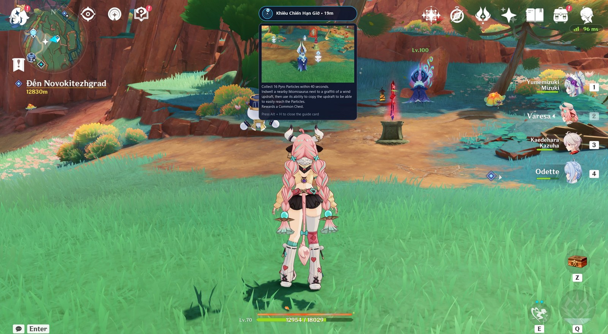
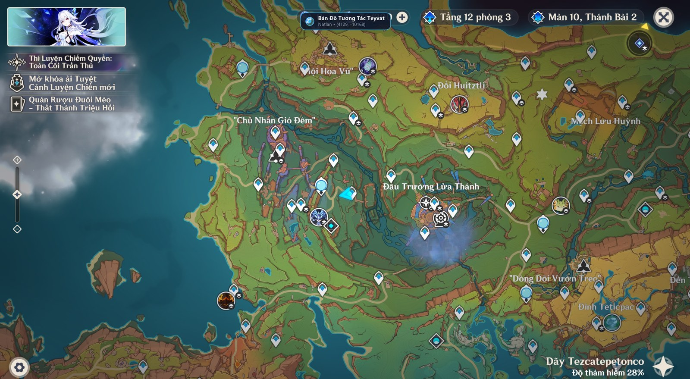
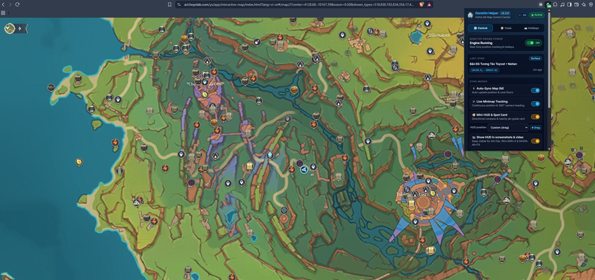

<div align="center">
  
  <h1>Genshin-Helper v5.7.0</h1>
  <p><strong>Trợ lý Định vị Thị giác Máy tính Thụ động 100%, Bản đồ Radar 60 fps &amp; Mini-HUD Điều hướng 360° cho HoYoLAB Interactive Map</strong></p>
  <p>
    <a href="README.md">English</a> | <strong>Tiếng Việt</strong>
  </p>
  <p>
    <a href="https://github.com/tuanminh26596/Genshin-helper/releases"></a>
    <a href="https://github.com/tuanminh26596/Genshin-helper/actions/workflows/ci.yml"></a>
    
    <a href="LICENSE"></a>
    <a href="https://ko-fi.com/minmories"></a>
  </p>
</div>

<p align="center">
  
</p>

---

## Tổng quan

**Genshin-Helper** là công cụ đồng bộ bản đồ chạy hoàn toàn cục bộ trên **Windows 10/11 64-bit** dành cho **Genshin Impact (PC Client)**. Ứng dụng dùng **Thị giác Máy tính (Computer Vision) thụ động 100%** để đồng bộ vị trí và góc nhìn 360° của bạn lên **Bản đồ tương tác HoYoLAB**, đồng thời hiển thị **Mini-HUD la bàn**, **Bản đồ nổi Live Radar 60 fps** và **lớp phủ tuyến đường trực tiếp trên Map (`M`)** giúp bạn săn Thần Đồng, Rương và Giải Đố mà không cần Alt+Tab liên tục.

### Điểm mới & Tính năng nổi bật (`v5.7.0`)

- **Bản đồ nổi Live Radar 60 fps (``Alt + ` ``) & Đồng bộ Tuyến đường (Mode A):** Mặc định TẮT (0% CPU/RAM khi chưa dùng). Hiển thị icon ghim chính chủ HoYoLAB, mũi tên nhân vật + nón camera 360°, đồng bộ tức thời bộ lọc ghim từ web map, và vẽ trực tiếp tuyến đường Web Route Companion (giữ nguyên các ghim đang lọc kèm đường nối theo chặng, ghim tuyến và phát sáng điểm dịch chuyển cần tới).
- **Lớp phủ Tuyến đường trên Map (`M`) & HUD hỗ trợ quay OBS/Video:** Vẽ tuyến đường đang mở ngay lên bản đồ toàn màn hình (`M`) theo dõi kéo/zoom mượt 60 Hz, cùng Mini-HUD la bàn 360° và Thẻ Hướng Dẫn (`Alt + H`) có công tắc **Hiện HUD khi chụp ảnh / quay phim** cho OBS, `Win+Shift+S`, Share Screen và NVIDIA `Alt + F9`.
- **Tự động hỗ trợ màn hình Windows HDR (`DXGI` + `WGC`):** Tự nhận diện màn hình HDR (`IDXGIOutput6` + mức trắng SDR), chụp khung hình 16-bit float qua Windows Graphics Capture kèm tone-mapping tự động, và tự chuyển mượt về GDI `SRCCOPY` trên màn SDR.
- **Theo dõi Minimap 60 Hz, Nón Camera ổn định & Nhận diện Tầng hang tổng quát:** Kết hợp SIFT + tương quan pha lọc Wiener + Sobel trên tile HD, tự chuyển tầng Mặt Đất ↔ Hang Ngầm theo nhận diện cấu trúc 0.5×, tự hiệu chỉnh Paimon và định vị lại toàn Teyvat bằng RootSIFT offline.
- **Tự động cập nhật xác thực SHA-256 & Nâng quyền không hiện UAC:** Tự kiểm tra bản phát hành mới từ GitHub Releases, đối chiếu mã băm FIPS 180-4 SHA-256 (`SHA256SUMS.txt`), hỗ trợ cập nhật im lặng 1 chạm và tác vụ nâng quyền (`GenshinHelper_Elevated`) tránh bật lại UAC.
- **Chống trùng Hotkey thông minh, Extension Control Center (MV3) & LAN Companion hợp nhất:** Phím tắt mặc định tay trái `Alt` không dùng `Shift/Ctrl`, hỗ trợ đổi phím NVIDIA Overlay có backup 1 chạm, chặn rò phím trigger bằng `WH_KEYBOARD_LL` (0 `SendInput`), lập tuyến TSP, xuất ghim sang Kongying/Appsample và LAN Companion (`:8766`) trên điện thoại/tablet dùng chung bộ icon, tuyến đường và bảng hướng dẫn/khóa ghim với Radar.

### Ảnh minh họa thực tế

<p align="center">
  
  
</p>
<p align="center">
  
</p>

---

## Miễn trừ trách nhiệm, An toàn Chống gian lận & Minh bạch

Xin đọc kỹ **6 lưu ý quan trọng** dưới đây trước khi tải và sử dụng:

1. **Rủi ro tài khoản & Điều khoản dịch vụ (Nói thẳng & Minh bạch):**
   - **Thực tế sử dụng:** Chính tác giả **vẫn đang dùng công cụ này hằng ngày trên tài khoản cá nhân**, và toàn bộ mã nguồn được thiết kế xoay quanh nguyên tắc thụ động tuyệt đối: **không đọc/ghi RAM game**, **không inject DLL**, **không hook DirectX/tiến trình game**, và **tuyệt đối không gọi `SendInput`** gửi phím hay chuột giả vào game.
   - **Cảnh báo quan trọng:** Dù thụ động đến đâu, đây vẫn là **phần mềm bên thứ ba không chính thức**, không liên kết hay được HoYoverse / COGNOSPHERE PTE. LTD bảo trợ. Không ai có thể cam kết **0% rủi ro khóa tài khoản**, và chính sách Điều khoản dịch vụ (ToS) hoặc cơ chế Anti-Cheat của HoYoverse có thể thay đổi bất cứ lúc nào. **Bạn tự cân nhắc và hoàn toàn chịu trách nhiệm khi sử dụng.**
2. **Cảnh báo Windows SmartScreen / Phần mềm diệt virus báo nhầm:**
   - Bộ cài `.exe` mã nguồn mở không ký chữ ký số thương mại — cộng thêm việc app có chụp ảnh màn hình Desktop và dùng Windows Global Hotkey Hook (`WH_KEYBOARD_LL` / `WH_MOUSE_LL`) — có thể khiến Windows SmartScreen hoặc Antivirus hiện cảnh báo kiểm tra.
   - Mọi file cài đặt chính thức đều được build công khai từ mã nguồn thuần Rust (7 crates) bằng [GitHub Actions](https://github.com/tuanminh26596/Genshin-helper/actions) kèm mã kiểm tra `SHA256SUMS.txt`. Bạn hoàn toàn có thể tự đọc từng dòng mã Rust/JS hoặc build trực tiếp từ mã nguồn (bộ cài `~7.8 MB`, `0` DLL ngoài).
3. **Quyền Administrator & Scheduled Task (`GenshinHelper_Elevated`):**
   - Vì Genshin Impact chạy dưới quyền Administrator nên cơ chế UIPI của Windows chặn phím tắt/lớp phủ từ app không có quyền Admin. Bộ cài Setup tạo sẵn 1 tác vụ nâng quyền (`GenshinHelper_Elevated`) để Extension bật tắt Desktop App mượt không hiện lại UAC. Khi gỡ cài đặt, tác vụ và registry được dọn sạch hoàn toàn.
4. **Tính năng đổi phím NVIDIA Overlay:**
   - Ứng dụng **không bao giờ tự ý sửa file hay registry của NVIDIA**. Chỉ khi bạn nhấn nút xác nhận trong Popup để "Chiếm & Đổi phím NVIDIA", app mới ghi thay đổi và luôn lưu bản sao lưu để hoàn tác về y như cũ chỉ bằng 1 click.
5. **Quyền riêng tư & Dữ liệu HoYoLAB:**
   - Ở lần chạy đầu tiên, Desktop App tự tải dữ liệu bản đồ công khai từ API HoYoLAB (~15 MB) về `%LOCALAPPDATA%\GenshinHelper\data`.
   - Tuyệt đối **không hỏi, không đọc và không gửi ra ngoài** mật khẩu hay cookie đăng nhập HoYoLAB (`ltoken_v2`, `cookie_token`). Server đồng bộ chỉ mở cục bộ trên `127.0.0.1:8765`, không telemetry.
   - Gói chẩn đoán (`Alt + F12`) tự động làm mờ góc UID trong ảnh, tuy nhiên bạn vẫn nên kiểm tra kỹ ảnh trước khi đính kèm lên GitHub Issue công khai.
6. **Phạm vi hỗ trợ & Không bảo hành:**
   - Chỉ hỗ trợ chính thức **Genshin Impact bản PC trên Windows 10/11 (64-bit)** (không hỗ trợ Mobile, Console, macOS/Linux hay Cloud Gaming).
   - Đây là dự án mã nguồn mở miễn phí ([Giấy phép MIT](LICENSE)) phát hành nguyên trạng (**AS IS**), được cập nhật theo thời gian rảnh khi có vùng đất/bản vá mới. Xem thêm [SECURITY.md](SECURITY.md) và [THIRD_PARTY_NOTICES.md](THIRD_PARTY_NOTICES.md).

---

## Cài đặt & Sử dụng nhanh

### Cách 1: Tải Bộ cài Windows Setup (`GenshinHelper-Setup-v5.7.0.exe`, ~7.8 MB, 0 DLL ngoài)

1. Tải file **`GenshinHelper-Setup-v5.7.0.exe`** tại mục [**GitHub Releases**](https://github.com/tuanminh26596/Genshin-helper/releases).
2. Chạy bộ cài và chấp nhận quyền Administrator để phím tắt hoạt động xuyên suốt trong game.
3. Ngay khi cài xong, trang **Hướng dẫn cài đặt Browser Extension** (`install_extension.html`) sẽ tự mở ra:
   - Mở `chrome://extensions` (hoặc `edge://extensions` / `brave://extensions`).
   - Bật **Developer mode** (Chế độ nhà phát triển) → nhấn **Load unpacked** → dán đường dẫn thư mục `extension` hiển thị sẵn trên trang hướng dẫn.
   - Ghim **biểu tượng Genshin Helper** lên thanh công cụ trình duyệt (ID cố định `nfkijdoblmphmdljfogooajhbldkeojh`).
4. Ở lần mở đầu tiên, Desktop App (`GenshinHelper.exe`) sẽ **tự động tải dữ liệu bản đồ HoYoLAB về `%LOCALAPPDATA%\GenshinHelper\data`** (mất khoảng 10–20 giây một lần duy nhất).
5. Mở [**HoYoLAB Interactive Map**](https://act.hoyolab.com/ys/app/interactive-map/index.html#/map/2), đặt Genshin Impact ở chế độ **Cửa sổ không viền (Borderless Windowed)**, bấm phím **`M`** một lần để khóa vị trí ban đầu rồi bắt đầu thám hiểm!

### Cách 2: Build & chạy từ mã nguồn Rust (Windows 10/11 64-bit, Rust 1.92+ / Edition 2024)

Yêu cầu: [Rustup (`msvc` stable)](https://rustup.rs/) và Visual Studio Build Tools (C++ workload).

```powershell
git clone https://github.com/tuanminh26596/Genshin-helper.git
cd Genshin-helper

Copy-Item config.example.json config.json
cargo build --manifest-path rust/Cargo.toml --release -p gh-app -p gh-host
```

(Tùy chọn) Tải trước dữ liệu bản đồ bằng tay (nếu bỏ qua, `GenshinHelper.exe` vẫn tự tải và kiểm tra phiên bản bản đồ trực tuyến ở lần chạy đầu):

```powershell
cargo run --manifest-path rust/Cargo.toml --release -p gh-app -- --sync-data
```

Đăng ký Native Messaging Host cho bản build dev và nạp thư mục `extension/` vào Chrome / Edge / Brave, sau đó chạy `GenshinHelper.exe` trực tiếp — ứng dụng sẽ tự hiện hộp thoại UAC xin quyền Administrator (thêm `--no-elevate` hoặc `GH_NO_ELEVATE=1` nếu muốn chạy quyền user thường; dùng `installer/build_release.ps1` cùng Inno Setup 6 để đóng gói `GenshinHelper-Setup-v5.7.0.exe`):

```powershell
pwsh -NoProfile -ExecutionPolicy Bypass -File scripts/register_dev_native_host.ps1
```

#### Cờ dòng lệnh (CLI) & Cấu hình `hoyolab_sync` (`config.json`)

- **Cờ CLI (`GenshinHelper.exe`):** `--sync-data` (tải/cập nhật dữ liệu HoYoLAB rồi thoát), `--no-tray`, `--standby`, `--minimized`, `--record-minimap <GIÂY>`, `--port <PORT>`, `--lan-port <LAN_PORT>`, `--config <PATH>`, `--no-mutex`, `--no-elevate`.
- **Tự kiểm tra phiên bản map trực tuyến (`hoyolab_sync` trong `config.json`):** Mặc định (`"auto_check_on_startup": true`, `"auto_update_mode": "auto_download"`), ứng dụng tự kiểm tra `map_version` mới trên HoYoLAB khi khởi động và cập nhật các gói dữ liệu thay đổi. Bạn có thể ghi đè `base_api`, `tile_base`, `rpc_map_version`, `default_map_ids`, `probe_id_range` hoặc đổi `"auto_update_mode"` sang `"notify_only"` / `"off"` trong `config.json`.

---

## Bảng phím tắt mặc định (`v5.7.0`)

Mọi phím tắt đều mặc định dùng tổ hợp **`Alt` tay trái không cần `Shift/Ctrl`** (không cấn phím Chạy/Đi bộ trong game) và chỉnh được trực tiếp trong **Extension Popup → Phím tắt** (kèm kiểm tra trùng phím tự động):

| Chức năng | Mặc định | Công dụng |
| --- | --- | --- |
| **Ghim mục tiêu HUD** | `Alt + F` | Đánh dấu đã thu thập mục tiêu hiện tại trên cả Desktop App lẫn web HoYoLAB mà không cần Alt+Tab (mục tiêu xa >25 m sẽ nhắc bấm thêm lần nữa để xác nhận). |
| **Hoàn tác ghim** | `Alt + T` | Khôi phục ghim vừa đánh dấu nhầm và tự bỏ ghim trên web HoYoLAB. |
| **Bật/Tắt Thẻ Hướng Dẫn** | `Alt + H` | Mở/đóng bảng ghi chú chi tiết & ảnh hướng dẫn của ghim đang chỉ tới. |
| **Chuyển mục tiêu kế** | `Alt + E` | Chuyển nhanh mũi tên sang ghim gần tiếp theo. |
| **Hủy khóa mục tiêu** | `Alt + F6` | Hủy ghim đang khóa dẫn đường thủ công (cũng có nút hủy trên Web Map và LAN Companion). |
| **Kéo/Chỉnh bố cục HUD & Radar** | `Alt + F7` | Bật/tắt chế độ kéo thả vị trí và đổi cỡ cho cả Mini-HUD lẫn Bản đồ nổi Live Radar. |
| **Ẩn / Hiện Mini-HUD** | `Alt + X` | Bật/tắt hiển thị lớp phủ Mini-HUD trực tiếp trong game. |
| **Bật / Tắt Bản đồ nổi Live Radar** | ``Alt + ` `` | Bật/tắt Bản đồ nổi Live Radar 60 fps (mặc định TẮT = 0% CPU/RAM). |
| **Sync Map (`M`) & Ghim gần nhất** | `Alt + F11` | Chụp bản đồ `M`, căn web HoYoLAB và ghim mục tiêu gần nhất (<60 m). |
| **Đảo nhanh Game ↔ Web Map** | `Alt + Q` | Đổi nhanh giữa game và tab bản đồ HoYoLAB (luôn bật khi engine đang chạy). |
| **Chụp gói Chẩn Đoán lỗi** | `Alt + F12` | Gom ảnh Game/Map (đã làm mờ UID) + log phục vụ gỡ lỗi cục bộ. |

> **Mẹo quay video NVIDIA `Alt + F9` kèm Mini-HUD:**
> Hãy bật công tắc **Hiện HUD khi chụp ảnh / quay phim** trong Tab Điều khiển của Popup. Công tắc này cho phép `Win+Shift+S`, OBS Display Capture và Share Screen nhìn thấy HUD. Riêng với **NVIDIA `Alt + F9`**, mặc định NVIDIA chỉ bắt hình trực tiếp từ DirectX của game nên sẽ bỏ qua các cửa sổ overlay — bạn cần vào **NVIDIA Overlay (`Alt + Z`) → Cài đặt (⚙️) → Quyền riêng tư (Privacy Control) → bật Desktop Capture (Quay màn hình nền)**.

---

## Bảng tương thích cài đặt game & Giới hạn hệ điều hành

Genshin-Helper chuẩn hóa tọa độ giao diện theo quy luật Unity `CanvasScaler` và xử lý minh bạch các giới hạn hiển thị của Windows / game:

| Cài đặt / Môi trường | Mức hỗ trợ | Hành vi & Khuyến nghị |
| --- | --- | --- |
| **Cửa sổ không viền (Borderless) / Cửa sổ (Windowed)** | Hỗ trợ đầy đủ | Khuyên dùng để hiển thị Mini-HUD, thông báo HUD Toast và dùng trên 1 màn hình. |
| **Toàn màn hình độc quyền (Exclusive Fullscreen)** *(Giới hạn cứng OS)* | Hạn chế (không hiện lớp phủ) | Windows DWM chặn cửa sổ lớp phủ hiển thị đè lên Exclusive Fullscreen. Hãy dùng nút **Khởi chạy Borderless 1-click** tích hợp (`-popupwindow -screen-fullscreen 0`) hoặc chuyển trong cài đặt game. |
| **Quyền Quản trị & UIPI** *(Giới hạn cứng Windows)* | Cần cùng mức quyền Admin | Genshin Impact chạy với quyền Administrator nên Windows UIPI chặn phím tắt toàn cục từ app thường. Hãy cài qua **Bộ cài Setup** (có sẵn tác vụ Admin) hoặc chạy source dưới quyền Administrator. |
| **Windows HDR / Auto-HDR** | Hỗ trợ đầy đủ *(Tự động WGC)* | Tự động nhận diện HDR qua DXGI (`IDXGIOutput6` + mức trắng SDR), chụp khung 16-bit float qua Windows Graphics Capture kèm tone-mapping, và tự lùi mượt về GDI `SRCCOPY` trên màn SDR. |
| **Tỷ lệ màn hình (`16:9`, `16:10`, `21:9`, `4:3`)** | Hỗ trợ đầy đủ | Tự động chuẩn hóa vùng minimap/HUD theo Unity `CanvasScaler` cho cả màn siêu rộng. |
| **Tỷ lệ phóng DPI Windows (`100%–200%`)** | Hỗ trợ đầy đủ | Xử lý DPI theo từng màn hình và tách hệ số X/Y chống lệch ở độ phân giải lẻ. |
| **Bàn phím/Chuột & Tay cầm (Controller/Gamepad)** | Hỗ trợ đầy đủ | Tự động nhận diện vùng an toàn minimap cho cả 2 chế độ điều khiển. |
| **Xoay Minimap (Khóa hướng Bắc & Xoay theo góc nhìn)** | Hỗ trợ đầy đủ | Hoạt động ở cả hai chế độ xoay minimap. |

---

## Kiến trúc hệ thống & Tài liệu liên quan

```text
+----------------------------------+          localhost:8765 (HTTP)         +---------------------------------+
|  Genshin-Helper Thuần Rust (x64) | <====================================> | Chrome / Edge / Brave Extension |
|  GenshinHelper.exe (0 DLL ngoài) |  Ring buffer /poll?since=<seq> lossless|  (MV3 Service Worker + Popup)   |
|  - Chụp WGC HDR / GDI SRCCOPY    |                                        |  - Cầu nối HoYoLAB Map & Route  |
|  - Định vị Map M & Minimap Rust  |        Native Messaging (stdio)        |  - Đồng bộ nền không giảm nhịp  |
|  - Mini-HUD, Live Radar & Map M  | <------------------------------------> |  - Tuyến TSP & Xuất ghim mở     |
|  - Cache cục bộ (%LOCALAPPDATA%) |   GenshinHelperHost.exe (ID cố định)   +---------------------------------+
+----------------------------------+
```

- **LAN Companion tùy chọn:** Chạy riêng trên cổng `8766` (`HTTP/WS`) khi được bật, dùng chung bộ đệm icon và tuyến đường với Live Radar.

- Chi tiết Browser Extension: [extension/README.md](extension/README.md)
- Giấy phép mã nguồn: [MIT License](LICENSE)
- Ghi nhận mã nguồn mở & Miễn trừ bản quyền HoYoverse: [THIRD_PARTY_NOTICES.md](THIRD_PARTY_NOTICES.md)
- Chính sách bảo mật: [SECURITY.md](SECURITY.md)
- Hướng dẫn đóng góp: [CONTRIBUTING.md](CONTRIBUTING.md)

---

## Ủng hộ tác giả (Donate)

Genshin-Helper **miễn phí 100%, mở mã nguồn và không quảng cáo** — mọi tính năng đều mở trọn vẹn. Mỗi lần Genshin Impact ra vùng đất mới (như Nod-Krai hay Snezhnaya sắp tới) đều cần thời gian cập nhật lại dữ liệu bản đồ, tầng hang ngầm và kiểm thử lại CV. Nếu công cụ giúp hành trình lụm rương / săn Thần Đồng của bạn nhàn hơn, một ly cà phê tự nguyện sẽ là động lực rất lớn để mình duy trì cập nhật nhanh & ổn định:

<p align="center">
  <a href="https://ko-fi.com/minmories"></a>
</p>

- **Ko-fi:** <https://ko-fi.com/minmories>
- **GitHub Sponsors:** `@tuanminh26596` *(đang chờ duyệt)*
- *Hoàn toàn tự nguyện — cảm ơn bạn đã đồng hành cùng dự án!*
