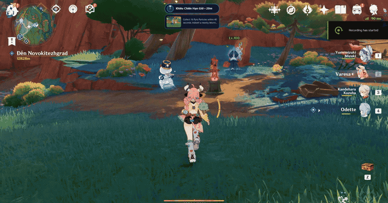

<div align="center">
  
  <h1>Genshin-Helper v5.4.0</h1>
  <p><strong>Trợ lý Định vị Thị giác Máy tính Thụ động 100% &amp; Mini-HUD Điều hướng 360° cho HoYoLAB Interactive Map</strong></p>
  <p>
    <a href="README.md">English</a> | <strong>Tiếng Việt</strong>
  </p>
  <p>
    <a href="https://github.com/tuanminh26596/Genshin-helper/releases"></a>
    <a href="https://github.com/tuanminh26596/Genshin-helper/actions/workflows/ci.yml"></a>
    
    <a href="LICENSE"></a>
    <a href="https://ko-fi.com/minmories"></a>
  </p>
</div>

<p align="center">
  
</p>

---

## Tổng quan

**Genshin-Helper** là công cụ đồng bộ bản đồ chạy hoàn toàn cục bộ trên **Windows 10/11 64-bit** dành cho **Genshin Impact (PC Client)**. Ứng dụng dùng **Thị giác Máy tính (Computer Vision) thụ động 100%** để đồng bộ vị trí và góc nhìn 360° của bạn lên **Bản đồ tương tác HoYoLAB**, đồng thời hiển thị **Mini-HUD la bàn** nổi trực tiếp trên màn hình game giúp bạn săn Thần Đồng, Rương và Giải Đố mà không cần Alt+Tab liên tục.

### Điểm mới & Tính năng nổi bật (`v5.4.0`)

- **Mini-HUD la bàn 360° & Thẻ Hướng Dẫn (Guide Card) ngay trong game:** Lớp phủ xuyên chuột mượt 30 Hz (`UpdateLayeredWindow`, mặc định `WDA_EXCLUDEFROMCAPTURE` ẩn khi chụp ảnh), có radar cận cảnh, bấm `Alt + H` xem ghi chú + ảnh minh họa từ cộng đồng HoYoLAB (tự đổi sang tiếng Anh/Việt theo ngôn ngữ Popup!), và công tắc **Hiện HUD khi chụp ảnh / quay phim** cho `Win+Shift+S`, OBS, Share Screen và NVIDIA `Alt + F9`.
- **Ưu tiên ghim gần nhất & Tự sửa lỗi mờ icon trên web Map:** Luôn ưu tiên mục tiêu chưa hoàn thành ở gần trước rồi mới xét phân hạng giá trị (**Thần Đồng > Đền Địa Linh/Rương Hiếm > Rương Cao Cấp/Kỳ Dị > Rương Thường > Giải Đố > Đặc Sản**). Đồng thời tự đồng bộ lại trạng thái mờ icon trên HoYoLAB để khi bạn bấm ghim từ trong game (`Alt + K`), web map không bị giữ sáng nhầm.
- **Theo dõi Minimap 60 Hz & Định vị lại toàn Teyvat (`V5.3+`):** Kết hợp tile HD + SIFT + Sobel, tự chuyển tầng Mặt Đất ↔ Hang Ngầm, tự hiệu chỉnh HUD và tự nhận diện lại vị trí toàn bản đồ bằng RootSIFT offline sau khi dịch chuyển xa.
- **Tự đồng bộ khi mở Map (`M`):** Hỗ trợ đa bản đồ (Teyvat, Enkanomiya, Vực Đá Sâu, Biển Kỷ Nguyên Cũ, Núi Thánh Cổ Đại, Đền Thờ Không Gian, Nod-Krai).
- **Chống trùng Hotkey thông minh & Đổi phím NVIDIA Overlay có backup:** Tự phát hiện phím trùng nội bộ, các phím menu của Genshin vẫn kích hoạt kể cả khi giữ `Alt` / `Alt+Shift` (như `G`, `Alt + G`, `Alt + Shift + G`, `Z`), xung đột Windows `RegisterHotKey` và phím tắt NVIDIA Overlay (`Alt + Z`, v.v.). Người dùng có thể bấm nút xác nhận để app dời phím của NVIDIA sang phím tùy chọn (tự động backup & hoàn tác 1 chạm) và chặn riêng phím trigger rò vào game bằng `WH_KEYBOARD_LL` (tuyệt đối không dùng `SendInput`).
- **Extension Control Center (MV3) & Công cụ farm tối ưu:** Giao diện web HoYoLAB gọn sạch, huy hiệu nguồn `ON` / `ZZZ` (nghỉ 0% CPU) / `OFF`, lập tuyến đường ngắn nhất TSP, xuất ghim sang Kongying Tavern / `genshinmap.github.io` / Appsample và chế độ xem phụ qua mạng LAN.

### Ảnh minh họa thực tế

<p align="center">
  
  
</p>
<p align="center">
  
</p>

---

## Miễn trừ trách nhiệm, An toàn Chống gian lận & Minh bạch

Xin đọc kỹ **6 lưu ý quan trọng** dưới đây trước khi tải và sử dụng:

1. **Rủi ro tài khoản & Điều khoản dịch vụ (Nói thẳng & Minh bạch):**
   - **Thực tế sử dụng:** Chính tác giả **vẫn đang dùng công cụ này hằng ngày trên tài khoản cá nhân**, và toàn bộ mã nguồn được thiết kế xoay quanh nguyên tắc thụ động tuyệt đối: **không đọc/ghi RAM game**, **không inject DLL**, **không hook DirectX/tiến trình game**, và **tuyệt đối không gọi `SendInput`** gửi phím hay chuột giả vào game.
   - **Cảnh báo quan trọng:** Dù thụ động đến đâu, đây vẫn là **phần mềm bên thứ ba không chính thức**, không liên kết hay được HoYoverse / COGNOSPHERE PTE. LTD bảo trợ. Không ai có thể cam kết **0% rủi ro khóa tài khoản**, và chính sách Điều khoản dịch vụ (ToS) hoặc cơ chế Anti-Cheat của HoYoverse có thể thay đổi bất cứ lúc nào. **Bạn tự cân nhắc và hoàn toàn chịu trách nhiệm khi sử dụng.**
2. **Cảnh báo Windows SmartScreen / Phần mềm diệt virus báo nhầm:**
   - Bộ cài `.exe` mã nguồn mở không ký chữ ký số thương mại — cộng thêm việc app có chụp ảnh màn hình Desktop và dùng Windows Global Hotkey Hook (`WH_KEYBOARD_LL` / `WH_MOUSE_LL`) — có thể khiến Windows SmartScreen hoặc Antivirus hiện cảnh báo kiểm tra.
   - Mọi file cài đặt chính thức đều được build công khai bằng [GitHub Actions](https://github.com/tuanminh26596/Genshin-helper/actions) kèm mã kiểm tra `SHA256SUMS.txt`. Bạn hoàn toàn có thể tự đọc mã nguồn hoặc chạy trực tiếp từ Python source.
3. **Quyền Administrator & Scheduled Task (`GenshinHelper_Elevated`):**
   - Vì Genshin Impact chạy dưới quyền Administrator nên cơ chế UIPI của Windows chặn phím tắt/lớp phủ từ app không có quyền Admin. Bộ cài Setup tạo sẵn 1 tác vụ nâng quyền (`GenshinHelper_Elevated`) để Extension bật tắt Desktop App mượt không hiện lại UAC. Khi gỡ cài đặt, tác vụ và registry được dọn sạch hoàn toàn.
4. **Tính năng đổi phím NVIDIA Overlay:**
   - Ứng dụng **không bao giờ tự ý sửa file hay registry của NVIDIA**. Chỉ khi bạn nhấn nút xác nhận trong Popup để "Chiếm & Đổi phím NVIDIA", app mới ghi thay đổi và luôn lưu bản sao lưu để hoàn tác về y như cũ chỉ bằng 1 click.
5. **Quyền riêng tư & Dữ liệu HoYoLAB:**
   - Ở lần chạy đầu tiên, Desktop App tự tải dữ liệu bản đồ công khai từ API HoYoLAB (~15 MB) về `%LOCALAPPDATA%\GenshinHelper\data`.
   - Tuyệt đối **không hỏi, không đọc và không gửi ra ngoài** mật khẩu hay cookie đăng nhập HoYoLAB (`ltoken_v2`, `cookie_token`). Server đồng bộ chỉ mở cục bộ trên `127.0.0.1:8765`, không telemetry.
   - Gói chẩn đoán (`Alt + F12`) tự động làm mờ góc UID trong ảnh, tuy nhiên bạn vẫn nên kiểm tra kỹ ảnh trước khi đính kèm lên GitHub Issue công khai.
6. **Phạm vi hỗ trợ & Không bảo hành:**
   - Chỉ hỗ trợ chính thức **Genshin Impact bản PC trên Windows 10/11 (64-bit)** (không hỗ trợ Mobile, Console, macOS/Linux hay Cloud Gaming).
   - Đây là dự án mã nguồn mở miễn phí ([Giấy phép MIT](LICENSE)) phát hành nguyên trạng (**AS IS**), được cập nhật theo thời gian rảnh khi có vùng đất/bản vá mới. Xem thêm [SECURITY.md](SECURITY.md) và [THIRD_PARTY_NOTICES.md](THIRD_PARTY_NOTICES.md).

---

## Cài đặt & Sử dụng nhanh

### Cách 1: Tải Bộ cài Windows Setup (Khuyên dùng)

1. Tải file **`GenshinHelper-Setup-v5.4.0.exe`** tại mục [**GitHub Releases**](https://github.com/tuanminh26596/Genshin-helper/releases).
2. Chạy bộ cài và chấp nhận quyền Administrator để phím tắt hoạt động xuyên suốt trong game.
3. Ngay khi cài xong, trang **Hướng dẫn cài đặt Browser Extension** (`install_extension.html`) sẽ tự mở ra:
   - Mở `chrome://extensions` (hoặc `edge://extensions` / `brave://extensions`).
   - Bật **Developer mode** (Chế độ nhà phát triển) → nhấn **Load unpacked** → dán đường dẫn thư mục `extension` hiển thị sẵn trên trang hướng dẫn.
   - Ghim **biểu tượng Genshin Helper** lên thanh công cụ trình duyệt (ID cố định `nfkijdoblmphmdljfogooajhbldkeojh`).
4. Ở lần mở đầu tiên, Desktop App sẽ **tự động tải dữ liệu bản đồ HoYoLAB về `%LOCALAPPDATA%\GenshinHelper\data`** (mất khoảng 10–20 giây một lần duy nhất).
5. Mở [**HoYoLAB Interactive Map**](https://act.hoyolab.com/ys/app/interactive-map/index.html#/map/2), đặt Genshin Impact ở chế độ **Cửa sổ không viền (Borderless Windowed)**, bấm phím **`M`** một lần để khóa vị trí ban đầu rồi bắt đầu thám hiểm!

### Cách 2: Chạy từ mã nguồn (Windows 10/11 64-bit, Python 3.11+)

```powershell
git clone https://github.com/tuanminh26596/Genshin-helper.git
cd Genshin-helper

python -m venv .venv
.\.venv\Scripts\python.exe -m pip install --upgrade pip
.\.venv\Scripts\python.exe -m pip install -r requirements.txt

Copy-Item config.example.json config.json
```

(Tùy chọn) Tải trước dữ liệu bản đồ bằng tay (nếu bỏ qua, `main.py` vẫn tự tải ở lần chạy đầu):

```powershell
.\.venv\Scripts\python.exe scripts/sync_hoyolab_data.py
```

Nạp thư mục `extension/` vào trình duyệt rồi chạy từ **PowerShell mở bằng quyền Administrator**:

```powershell
.\.venv\Scripts\python.exe main.py
```

---

## Bảng phím tắt mặc định (`v5.4.0`)

Mọi phím tắt đều chỉnh được trực tiếp trong **Extension Popup → Phím tắt & Debug** (kèm kiểm tra trùng phím tự động):

| Chức năng | Mặc định | Công dụng |
| --- | --- | --- |
| **Ghim mục tiêu HUD** | `Alt + K` | Đánh dấu đã thu thập mục tiêu hiện tại trên cả Desktop App lẫn web HoYoLAB mà không cần Alt+Tab (mục tiêu xa >25 m sẽ nhắc bấm thêm lần nữa để xác nhận). |
| **Hoàn tác ghim** | `Alt + Shift + K` | Khôi phục ghim vừa đánh dấu nhầm và tự bỏ ghim trên web HoYoLAB. |
| **Bật/Tắt Thẻ Hướng Dẫn** | `Alt + H` | Mở/đóng bảng ghi chú chi tiết & ảnh hướng dẫn của ghim đang chỉ tới. |
| **Chuyển mục tiêu kế** | `Alt + N` | Chuyển nhanh mũi tên sang ghim gần tiếp theo. |
| **Kéo đặt vị trí Mini-HUD** | `Alt + Shift + H` | Bật/tắt chế độ kéo thả Mini-HUD (giữ `Alt` trong game để kéo HUD tới vị trí bất kỳ). |
| **Sync Map (`M`) & Ghim gần nhất** | `Alt + F11` | Chụp bản đồ `M`, căn web HoYoLAB và ghim mục tiêu gần nhất (<60 m). |
| **Đảo nhanh Game ↔ Web Map** | `Alt + Q` | Đổi cửa sổ nhanh khi chơi 1 màn hình (Chế độ 1 Màn Hình). |
| **Chụp gói Chẩn Đoán lỗi** | `Alt + F12` | Gom ảnh Game/Map (đã làm mờ UID) + log phục vụ gỡ lỗi cục bộ. |

> **Mẹo quay video NVIDIA `Alt + F9` kèm Mini-HUD:**
> Hãy bật công tắc **Hiện HUD khi chụp ảnh / quay phim** trong Tab Điều khiển của Popup. Công tắc này cho phép `Win+Shift+S`, OBS Display Capture và Share Screen nhìn thấy HUD. Riêng với **NVIDIA `Alt + F9`**, mặc định NVIDIA chỉ bắt hình trực tiếp từ DirectX của game nên sẽ bỏ qua các cửa sổ overlay — bạn cần vào **NVIDIA Overlay (`Alt + Z`) → Cài đặt (⚙️) → Quyền riêng tư (Privacy Control) → bật Desktop Capture (Quay màn hình nền)**.

---

## Bảng tương thích cài đặt game & Giới hạn hệ điều hành

Genshin-Helper chuẩn hóa tọa độ giao diện theo quy luật Unity `CanvasScaler` và xử lý minh bạch **3 giới hạn cứng của Windows / game**:

| Cài đặt / Môi trường | Mức hỗ trợ | Hành vi & Khuyến nghị |
| --- | --- | --- |
| **Cửa sổ không viền (Borderless) / Cửa sổ (Windowed)** | Hỗ trợ đầy đủ | Khuyên dùng để hiển thị Mini-HUD, thông báo HUD Toast và dùng trên 1 màn hình. |
| **Toàn màn hình độc quyền (Exclusive Fullscreen)** *(Giới hạn cứng OS)* | Hạn chế (không hiện lớp phủ) | Windows DWM chặn cửa sổ lớp phủ hiển thị đè lên Exclusive Fullscreen. Hãy dùng nút **Khởi chạy Borderless 1-click** tích hợp (`-popupwindow -screen-fullscreen 0`) hoặc chuyển trong cài đặt game. |
| **Quyền Quản trị & UIPI** *(Giới hạn cứng Windows)* | Cần cùng mức quyền Admin | Genshin Impact chạy với quyền Administrator nên Windows UIPI chặn phím tắt toàn cục từ app thường. Hãy cài qua **Bộ cài Setup** (có sẵn tác vụ Admin) hoặc chạy source dưới quyền Administrator. |
| **Windows Auto-HDR / HDR** *(Giới hạn cứng OS/Capture)* | Giảm độ chính xác / nhánh SDR | Ánh xạ màu HDR/Auto-HDR làm lệch ngưỡng màu và mất kênh Alpha khi chụp màn hình. Hãy tắt **Auto-HDR** cho Genshin Impact trong cài đặt hiển thị Windows. |
| **Tỷ lệ màn hình (`16:9`, `16:10`, `21:9`, `4:3`)** | Hỗ trợ đầy đủ | Tự động chuẩn hóa vùng minimap/HUD theo Unity `CanvasScaler` cho cả màn siêu rộng. |
| **Tỷ lệ phóng DPI Windows (`100%–200%`)** | Hỗ trợ đầy đủ | Xử lý DPI theo từng màn hình và tách hệ số X/Y chống lệch ở độ phân giải lẻ. |
| **Bàn phím/Chuột & Tay cầm (Controller/Gamepad)** | Hỗ trợ đầy đủ | Tự động nhận diện vùng an toàn minimap cho cả 2 chế độ điều khiển. |
| **Xoay Minimap (Khóa hướng Bắc & Xoay theo góc nhìn)** | Hỗ trợ đầy đủ | Hoạt động ở cả hai chế độ xoay minimap. |

---

## Kiến trúc hệ thống & Tài liệu liên quan

```text
+----------------------------------+        localhost:8765 (HTTP/WS)        +---------------------------------+
|   Genshin-Helper Desktop (Win64) | <====================================> | Chrome / Edge / Brave Extension |
|                                  |  Ring buffer /poll?since=<seq> lossless|  (MV3 Service Worker + Popup)   |
|  - Chụp màn hình thụ động        |                                        |  - Cầu nối DOM HoYoLAB Map      |
|  - Bộ định vị Map M & Minimap    |        Native Messaging (stdio)        |  - Đồng bộ nền không giảm nhịp  |
|  - Góc nhìn 360° & Mini-HUD      | <------------------------------------> |  - Tuyến TSP & Xuất ghim mở     |
|  - Cache cục bộ (%LOCALAPPDATA%) |    com.genshinhelper.host (ID cố định) +---------------------------------+
+----------------------------------+
```

- Chi tiết Browser Extension: [extension/README.md](extension/README.md)
- Giấy phép mã nguồn: [MIT License](LICENSE)
- Ghi nhận mã nguồn mở & Miễn trừ bản quyền HoYoverse: [THIRD_PARTY_NOTICES.md](THIRD_PARTY_NOTICES.md)
- Chính sách bảo mật: [SECURITY.md](SECURITY.md)
- Hướng dẫn đóng góp: [CONTRIBUTING.md](CONTRIBUTING.md)

---

## Ủng hộ tác giả (Donate)

Genshin-Helper hoàn toàn miễn phí và mở mã nguồn. Nếu công cụ giúp hành trình lụm rương / tìm Thần Đồng của bạn nhàn hơn, bạn có thể mời mình một ly cà phê tại đây:

- **Ko-fi (Quốc tế):** <https://ko-fi.com/minmories>
- **GitHub Sponsors:** Tài khoản `@tuanminh26596` đang chờ xét duyệt *(sắp ra mắt)*
- **MoMo / VietQR (Việt Nam):**

<p align="center">
  
</p>
